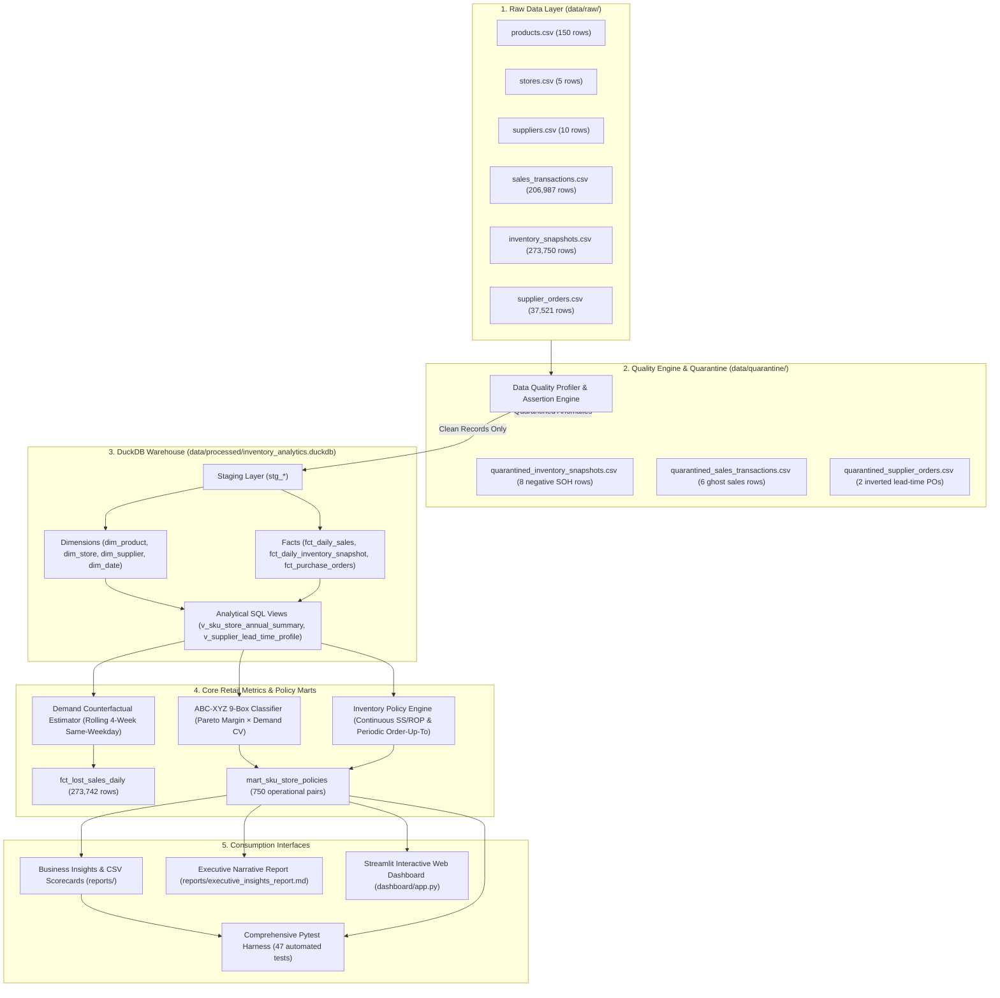

# 📦 Smart Inventory Diagnostics: Retail Supply Chain Analytics
**Optimizing Safety Stock, Reorder Points, and Stockout Risk in Multi-Echelon Retail Supply Chains**

[](https://www.python.org/)
[](https://duckdb.org/)
[](https://streamlit.io/)
[-brightgreen.svg)](https://pytest.org/)
[](LICENSE)

An enterprise-grade, portfolio-quality supply chain analytics platform designed to diagnose stockout risk, reconstruct unfulfilled customer demand using **rolling counterfactual baselines**, calibrate **bivariate safety stock and dynamic reorder points**, decompose working capital driven by supplier delivery volatility, and automate daily procurement recommendations.

---

## 📑 Table of Contents
* [1. Executive Summary & Key Results](#1-executive-summary--key-results)
* [2. System Architecture & Data Flow](#2-system-architecture--data-flow)
* [3. Mathematical Formulation & Policy Engine](#3-mathematical-formulation--policy-engine)
* [4. Interactive Streamlit Dashboard](#4-interactive-streamlit-dashboard)
* [5. Project Directory Structure](#5-project-directory-structure)
* [6. Installation & Quick Start](#6-installation--quick-start)
* [7. Master Pipeline Orchestration](#7-master-pipeline-orchestration)
* [8. Automated Testing & Verification](#8-automated-testing--verification)
* [9. Governance & Methodology Notice](#9-governance--methodology-notice)

---

## 1. Executive Summary & Key Results

Evaluating a retail supply chain network of **5 stores**, **150 SKUs** (750 operational pairs), and **10 suppliers** across a 365-day historical trading period (518,423 audited records):

```
┌─────────────────────────────────┬─────────────────────────────────┬─────────────────────────────────┐
│       GROSS SALES REVENUE       │   CONTRIBUTION MARGIN (42.2%)   │      NETWORK STOCKOUT RATE      │
│         $100,558,841.75         │         $42,464,922.02          │              6.93%              │
├─────────────────────────────────┼─────────────────────────────────┼─────────────────────────────────┤
│    MODELED LOST SALES REVENUE   │    MODELED LOST GROSS MARGIN    │     ANNUALIZED HOLDING COST     │
│         $10,074,157.71          │          $4,313,057.21          │       $211,738.89 (at 22%)      │
├─────────────────────────────────┼─────────────────────────────────┼─────────────────────────────────┤
│   SUPPLIER VARIANCE SS BUFFER   │    CRITICAL REORDER ALERTS      │    FULL TEST SUITE PASS RATE    │
│    $287,301.65 (22.8% of SS)    │   40 pairs (18,124 units / $538K) │     47 / 47 Passed (100%)       │
└─────────────────────────────────┴─────────────────────────────────┴─────────────────────────────────┘
```

### Strategic Supply Chain Findings:
1. **The True Cost of Stockouts:** Sub-optimal inventory buffering caused a **6.93% network stockout rate** (18,963 stockout days). Using a rolling 4-week same-weekday in-stock baseline, unfulfilled customer demand accounted for **217,026 lost units**, representing **\$10.07M in modeled lost sales** and **\$4.31M in lost margin**.
2. **The 80/20 Margin Concentration (ABC Pareto):** 141 SKU-Store pairs (**18.8% of portfolio**) generate **\$33.94M (79.93%)** of network gross margin. Segmenting policies to target 99% CSL for Class A items protects 80% of cash flow while maintaining lean buffers for the Class C long tail.
3. **Supplier Delivery Variance Ties Up \$287K:** Decomposing safety stock into customer demand volatility vs vendor lead-time variance reveals that **9,953 buffer units (22.8% of network safety stock)** and **\$287,301.65 in working capital** exist solely to hedge against supplier delivery unreliability.

---

## 2. System Architecture & Data Flow

The project adheres to a four-tier data architecture (**Raw $\rightarrow$ Quarantine $\rightarrow$ Warehouse $\rightarrow$ Analytics & Consumption**), preserving raw source immutability while maintaining a clean DuckDB analytical warehouse:



---

## 3. Mathematical Formulation & Policy Engine

### A. Rolling 4-Week Same-Weekday Counterfactual Demand
To model true unconstrained demand during stockouts ($\text{SOH} \le 0$) without future data leakage, counterfactual demand $\hat{D}_{i,s,t}$ uses in-stock sales on identical weekdays over the preceding 4 weeks:

$$\hat{D}_{i,s,t} = \frac{1}{|K|} \sum_{k \in K} \text{units\_fulfilled}_{i,s,t - 7k}$$

$$\text{Estimated Lost Units}_{i,s,t} = \max(0, \lceil \hat{D}_{i,s,t} \rceil - \text{units\_fulfilled}_{i,s,t}) \quad (\text{when } \text{is\_stockout}_{i,s,t} = 1)$$

$$\text{Estimated Lost Revenue}_{i,s,t} = \text{Estimated Lost Units}_{i,s,t} \times \text{unit\_selling\_price}_i$$

### B. Continuous-Review Bivariate Safety Stock & Reorder Point
Accounts simultaneously for demand fluctuations ($\sigma_D^2$) and supplier delivery lead-time variance ($\sigma_L^2$):

$$SS_{\text{cont}} = \left\lceil Z \times \sqrt{\bar{L} \cdot \sigma_D^2 + \bar{D}^2 \cdot \sigma_L^2} \right\rceil$$

$$ROP = \left\lceil (\bar{D} \times \bar{L}) + SS_{\text{cont}} \right\rceil$$

### C. Periodic-Review Safety Stock & Order-Up-To Level ($R = 7$ Days)
For retail stores operating on fixed weekly replenishment delivery schedules:

$$SS_{\text{periodic}} = \left\lceil Z \times \sqrt{(\bar{L} + R) \cdot \sigma_D^2 + \bar{D}^2 \cdot \sigma_L^2} \right\rceil$$

$$\text{Order-Up-To Level} = \left\lceil \bar{D} \times (\bar{L} + R) + SS_{\text{periodic}} \right\rceil$$

$$\text{Recommended Reorder Qty} = \max\left(0, \text{Order-Up-To Level} - (\text{SOH} + \text{In Transit})\right)$$

### D. Supplier Variance Buffer Decomposition
Isolates the working capital tied up strictly due to supplier delivery unreliability:

$$SS_{\text{deterministic}} = \left\lceil Z \times \sqrt{\bar{L} \cdot \sigma_D^2} \right\rceil$$

$$\Delta SS_{\text{supplier}} = SS_{\text{actual}} - SS_{\text{deterministic}}$$

$$\Delta \text{Working Capital}_{\text{supplier}} = \Delta SS_{\text{supplier}} \times \text{unit\_cost}$$

---

## 4. Interactive Streamlit Dashboard

Launch the interactive supply chain command center with:

```powershell
streamlit run dashboard/app.py
```

* **Executive Scorecard:** Real-time macro KPIs, monthly sales vs lost revenue trends, category contribution margin donut chart, and store performance table.
* **ABC-XYZ Portfolio Matrix:** 9-box heatmap, interactive scatter plot (Margin Pareto vs Demand CV), and actionable segment playbooks.
* **Service Level Simulator:** Dynamic slider (85% to 99.5% CSL) recalculating network safety stock units and capital investment in real time with an exponential frontier curve.
* **Procurement Action Center:** Operational workbench filtering CRITICAL and HIGH alerts, with one-click purchase order CSV export.
* **Supplier Reliability:** Lead-time distributions and working capital decomposition by vendor.
* **Data Governance & Audit:** Complete pipeline audit reconciliation and quarantine logs.

---

## 5. Project Directory Structure

```text
inventory_analytics/
│
├── data/
│   ├── raw/                              # Immutable source CSV files (518k rows)
│   │   ├── products.csv
│   │   ├── stores.csv
│   │   ├── suppliers.csv
│   │   ├── sales_transactions.csv
│   │   ├── inventory_snapshots.csv
│   │   └── supplier_orders.csv
│   ├── quarantine/                       # Isolated anomalous records & audit logs
│   │   ├── quarantined_inventory_snapshots.csv  (8 negative SOH rows)
│   │   ├── quarantined_sales_transactions.csv   (6 ghost sales rows)
│   │   ├── quarantined_supplier_orders.csv      (2 inverted lead-time POs)
│   │   ├── data_quality_findings.csv
│   │   └── raw_data_profiles.json
│   └── processed/                        # DuckDB analytical warehouse
│       └── inventory_analytics.duckdb    (Columnar database, 12.3 MB)
│
├── sql/                                  # Modular DuckDB SQL DDL & transformations
│   ├── 01_create_staging.sql             # Staging tables filtering out quarantined rows
│   ├── 02_create_dimensions.sql          # Dimension tables (product, store, supplier, date)
│   ├── 03_create_fact_tables.sql         # Fact tables (daily sales, inventory, POs)
│   └── 04_create_analytics_views.sql     # Dimensional summary views & lead-time profiles
│
├── src/                                  # Core Python analytical engines
│   ├── data_generation.py                # Synthetic retail data generator engine
│   ├── data_profiler.py                  # Automated schema and statistics profiler
│   ├── data_quality.py                   # Data quality assertion rule checker
│   ├── quarantine.py                     # Non-destructive anomaly quarantine manager
│   ├── run_quality_audit.py              # Phase 2 audit pipeline runner
│   ├── build_database.py                 # Phase 3 DuckDB warehouse builder
│   ├── demand_estimator.py               # Rolling 4-week counterfactual lost sales estimator
│   ├── abc_xyz_segmentation.py           # Pareto margin (ABC) & demand CV (XYZ) classifier
│   ├── inventory_policy.py               # Continuous SS/ROP & periodic Order-Up-To engine
│   ├── run_phase_4_metrics.py            # Phase 4 metrics orchestrator
│   └── analytics_reporting.py            # Phase 5 reporting & scorecard exporter
│
├── dashboard/                            # Interactive presentation layer
│   └── app.py                            # Multi-tab interactive Streamlit dashboard
│
├── reports/                              # Generated business reports & scorecards
│   ├── executive_insights_report.md      # 15 KB executive analytical narrative
│   ├── executive_scorecard.csv           # Macro supply chain KPIs
│   ├── store_performance.csv             # Store sales, margin, and stockouts
│   ├── category_diagnostics.csv          # Merchandising performance & turnover
│   ├── abc_xyz_portfolio_analysis.csv    # 9-box distribution & playbook strategies
│   ├── supplier_performance_and_lead_time.csv  # Vendor reliability & buffer capital
│   ├── service_level_tradeoffs.csv       # 90% vs 95% vs 99% CSL scenario modeling
│   ├── priority_action_list.csv          # Operational replenishment worklist (CRITICAL & HIGH)
│   ├── synthetic_spoilage_diagnostics.csv # Isolated perishables risk module
│   └── data_quality_reconciliation_summary.csv # Zero-variance audit reconciliation
│
├── docs/                                 # Governance & operational documentation
│   ├── analysis_scope.md                 # Scope, grains, boundaries, and success criteria
│   ├── metric_definitions.md             # Mathematical data dictionary
│   ├── decisions_log.md                  # Approved decisions log (DEC-001 to DEC-019)
│   ├── assumptions_and_limitations.md    # Documented constraints & assumptions
│   ├── data_quality_findings.md          # Automated audit findings report
│   ├── architecture.md                   # System architecture & dimensional models
│   ├── testing_report.md                 # Formal QA test audit report (47 tests)
│   └── runbook.md                        # Operator runbook & command reference
│
├── tests/                                # Automated pytest test harness (47 tests)
│   ├── test_data_quality.py              # 10 tests: schema, PK/FK, quarantine, immutability
│   ├── test_staging_and_sql.py           # 7 tests: DuckDB tables, views, row reconciliation
│   ├── test_metrics_and_policies.py      # 9 tests: counterfactuals, ABC-XYZ, SS/ROP math
│   ├── test_analytics_and_reporting.py   # 9 tests: cross-report parity, vendor variance
│   ├── test_dashboard.py                 # 4 tests: compilation, queries, simulator math
│   └── test_end_to_end_integration.py    # 8 tests: calendar continuity, stress & boundaries
│
├── run_pipeline.py                       # Single-command CLI master orchestrator
└── requirements.txt                      # Project dependency specification
```

---

## 6. Installation & Quick Start

### Prerequisites
* Windows PowerShell (or Linux/macOS bash)
* Python 3.14+ (or Python 3.10+)

### Setup Instructions (Windows)

```powershell
# 1. Clone or navigate to the repository
cd C:\Users\venut\Desktop\inventory_analytics

# 2. Activate the dedicated virtual environment
.\.venv\Scripts\Activate.ps1

# 3. Verify dependency health
python -m pip check
```

---

## 7. Master Pipeline Orchestration

Reproduce the entire supply chain analytics platform with a single command:

```powershell
python run_pipeline.py --all
```

*Executes Stage 1 (Quality Audit) $\rightarrow$ Stage 2 (DuckDB Warehouse Build) $\rightarrow$ Stage 3 (Metrics & Policies Engine) $\rightarrow$ Stage 4 (Reporting) in **~17.5 seconds** with zero manual intervention.*

### Useful CLI Commands:
```powershell
python run_pipeline.py --audit-only         # Profile raw data and isolate anomalies
python run_pipeline.py --build-db-only      # Build DuckDB SQL warehouse
python run_pipeline.py --metrics-only       # Calibrate lost sales and inventory policies
python run_pipeline.py --reports-only       # Generate all 10 CSV and Markdown reports
python run_pipeline.py --run-tests          # Run the full 47-test pytest suite
python run_pipeline.py --launch-dashboard   # Launch Streamlit web dashboard
```

---

## 8. Automated Testing & Verification

Execute the complete 47-assertion test harness:

```powershell
python -m pytest tests -v
```

```text
============================= 47 passed in 23.81s =============================
```

* **10 Data Quality Tests:** Verified primary-key uniqueness, referential integrity, quarantine isolation, and raw CSV SHA-256 immutability.
* **7 Staging & SQL Tests:** Verified DuckDB table schemas, view executions, and row-count reconciliation parity.
* **9 Core Metrics & Policy Tests:** Proved absence of future leakage in rolling counterfactual demand, ABC Pareto distribution, and bivariate safety stock math.
* **9 Analytics Reporting Tests:** Proved cross-report financial parity (Store Revenue == Category Revenue == Scorecard Revenue) and supplier buffer decomposition.
* **4 Dashboard Tests:** Proved dashboard script compilation, cached queries, and simulator scaling.
* **8 End-to-End Integration Tests:** Proved 365-day calendar continuity, absence of duplicate natural keys, zero-demand boundary safety, and query determinism.

---

## 9. Governance & Methodology Notice

1. **Lost Sales Counterfactual Disclaimer:** Modeled lost units (**217,026 units**) and lost revenue (**\$10.07M**) are unconstrained demand estimates based on preceding same-weekday velocity over in-stock trading days. They represent modeled commercial opportunity cost, not audited accounting write-offs.
2. **Synthetic Perishables Module Isolation:** Per Decision `DEC-011`, perishability and spoilage risk are evaluated strictly in an isolated synthetic demonstration module ([`reports/synthetic_spoilage_diagnostics.csv`](file:///C:/Users/venut/Desktop/inventory_analytics/reports/synthetic_spoilage_diagnostics.csv)) and are completely segregated from core replenishment and continuous safety-stock models.
3. **Decisions Log Governance:** All architectural and methodology decisions (`DEC-001` through `DEC-019`) have been formally approved and logged in [`docs/decisions_log.md`](file:///C:/Users/venut/Desktop/inventory_analytics/docs/decisions_log.md).
