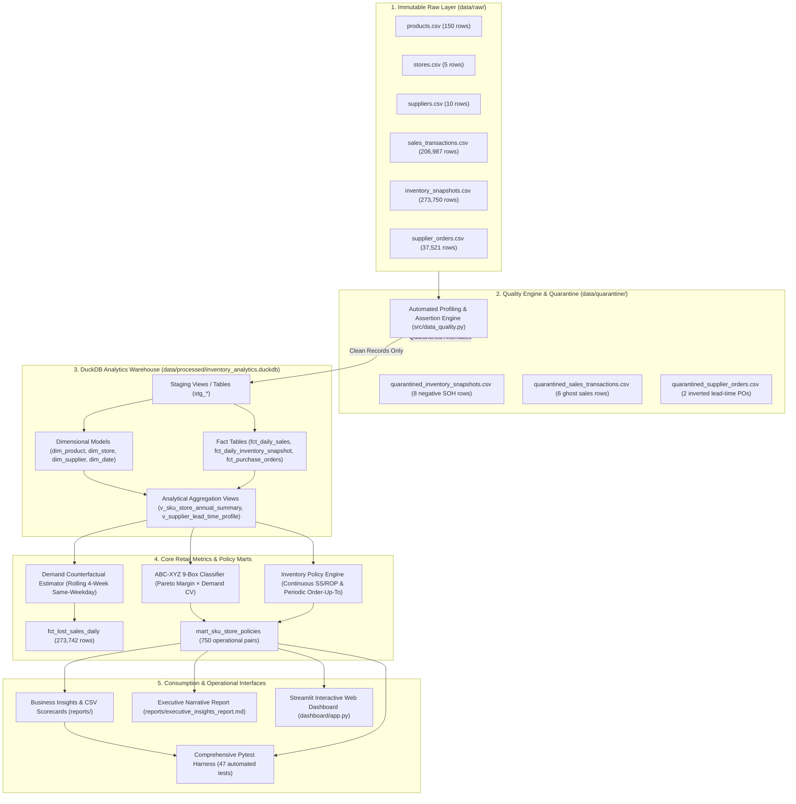
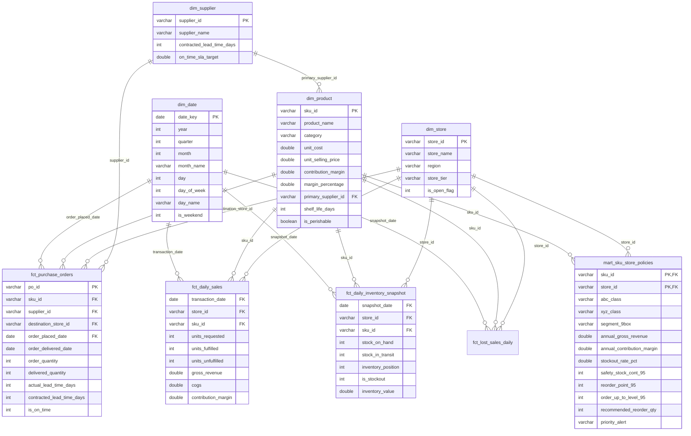

# 🏛️ System Architecture & Data Engineering Design
**Smart Inventory Diagnostics: Retail Supply Chain Analytics**

This document details the end-to-end data engineering architecture, relational modeling, mathematical policy engine, and technical design governing the project.

---

## 1. High-Level Data Flow Architecture

The data pipeline enforces a strict four-layer architecture (**Raw $\rightarrow$ Quarantine $\rightarrow$ Warehouse $\rightarrow$ Analytics & Consumption**), ensuring source immutability, data quality governance, and reproducible calculations:

---

## 2. Relational Star Schema Data Model

The DuckDB analytical warehouse models retail operations using an enterprise star schema optimized for fast analytical aggregations and window operations:

---

## 3. Mathematical Policy Formulations

### A. Rolling 4-Week Same-Weekday Counterfactual Demand
To model true unconstrained customer demand during stockouts ($\text{SOH} \le 0$) without future data leakage, the counterfactual demand $\hat{D}_{i,s,t}$ is calculated as the average fulfilled demand during in-stock trading days on the identical day-of-week over the preceding 4 weeks:

$$\hat{D}_{i,s,t} = \frac{1}{|K|} \sum_{k \in K} \text{units\_fulfilled}_{i,s,t - 7k}$$

Where:
* $K = \{k \in \{1, 2, 3, 4\} \mid \text{is\_stockout}_{i,s,t - 7k} = 0\}$
* If $|K| = 0$ (sustained multi-week stockout), the model safely falls back to the prior in-stock trading day velocity.

$$\text{Estimated Lost Units}_{i,s,t} = \begin{cases} \max(0, \lceil \hat{D}_{i,s,t} \rceil - \text{units\_fulfilled}_{i,s,t}), & \text{if } \text{is\_stockout}_{i,s,t} = 1 \\ 0, & \text{otherwise} \end{cases}$$

$$\text{Estimated Lost Revenue}_{i,s,t} = \text{Estimated Lost Units}_{i,s,t} \times \text{unit\_selling\_price}_i$$

$$\text{Estimated Lost Margin}_{i,s,t} = \text{Estimated Lost Units}_{i,s,t} \times \text{contribution\_margin}_i$$

---

### B. Continuous-Review Bivariate Safety Stock & Reorder Point
Demand and supplier lead times are both treated as random variables. Safety stock ($SS$) accounts for both customer demand volatility ($\sigma_D^2$) and supplier lead-time variance ($\sigma_L^2$):

$$SS_{\text{cont}} = \left\lceil Z \times \sqrt{\bar{L} \cdot \sigma_D^2 + \bar{D}^2 \cdot \sigma_L^2} \right\rceil$$

$$ROP = \left\lceil (\bar{D} \times \bar{L}) + SS_{\text{cont}} \right\rceil$$

Where:
* $Z$: Gaussian standard normal inverse CDF corresponding to the target Cycle Service Level ($Z = 1.282$ for 90%, $1.645$ for 95%, $2.326$ for 99%).
* $\bar{D}$: Empirical mean daily demand over in-stock trading days.
* $\sigma_D^2$: Sample variance of daily demand over in-stock trading days.
* $\bar{L}$: Empirical mean lead time (days) for the assigned supplier.
* $\sigma_L^2$: Sample variance of supplier delivery lead time ($\text{days}^2$).

---

### C. Periodic-Review Safety Stock & Order-Up-To Level ($R = 7$ Days)
For retail environments with fixed weekly replenishment delivery windows ($R = 7$ days), inventory exposure extends over the entire lead-time plus review cycle ($\bar{L} + R$):

$$SS_{\text{periodic}} = \left\lceil Z \times \sqrt{(\bar{L} + R) \cdot \sigma_D^2 + \bar{D}^2 \cdot \sigma_L^2} \right\rceil$$

$$\text{Order-Up-To Level} = \left\lceil \bar{D} \times (\bar{L} + R) + SS_{\text{periodic}} \right\rceil$$

$$\text{Recommended Reorder Qty} = \max\left(0, \text{Order-Up-To Level} - \text{Current Inventory Position}\right)$$

Where $\text{Current Inventory Position} = \text{Stock on Hand} + \text{Stock in Transit}$.

---

### D. Supplier Variance Buffer Decomposition
The incremental safety stock units ($\Delta SS$) and working capital ($\Delta C$) necessitated strictly by vendor delivery unreliability ($\sigma_L^2 > 0$) is isolated by:

$$SS_{\text{deterministic}} = \left\lceil Z \times \sqrt{\bar{L} \cdot \sigma_D^2} \right\rceil$$

$$\Delta SS_{\text{supplier}} = SS_{\text{actual}} - SS_{\text{deterministic}}$$

$$\Delta C_{\text{supplier}} = \Delta SS_{\text{supplier}} \times \text{unit\_cost}$$

---

### E. Operational Alert Classification Boundaries

Current inventory positions are evaluated against policy boundaries:

$$\text{Priority Alert} = \begin{cases} 
\textbf{CRITICAL}, & \text{if } \text{Position} \le SS_{\text{primary}} \\ 
\textbf{HIGH}, & \text{if } SS_{\text{primary}} < \text{Position} \le ROP_{\text{primary}} \\ 
\textbf{MEDIUM}, & \text{if } ROP_{\text{primary}} < \text{Position} \le 1.10 \times ROP_{\text{primary}} \\ 
\textbf{HEALTHY}, & \text{if } \text{Position} > 1.10 \times ROP_{\text{primary}} 
\end{cases}$$

---

## 4. Technology Stack & Design Principles

* **Database Engine:** Embedded **DuckDB** for vectorized, high-performance in-process SQL execution.
* **Core Languages & Libraries:** Python 3.14, pandas, NumPy, SciPy, pytest.
* **Visualization & Presentation:** Streamlit (wide layout) with declarative Altair graphics.
* **Strict Raw Immutability:** Source CSV files in `data/raw/` are read-only and never modified in place.
* **Idempotent Pipelines:** Every pipeline stage produces deterministic, identical outputs when rerun with identical inputs.
